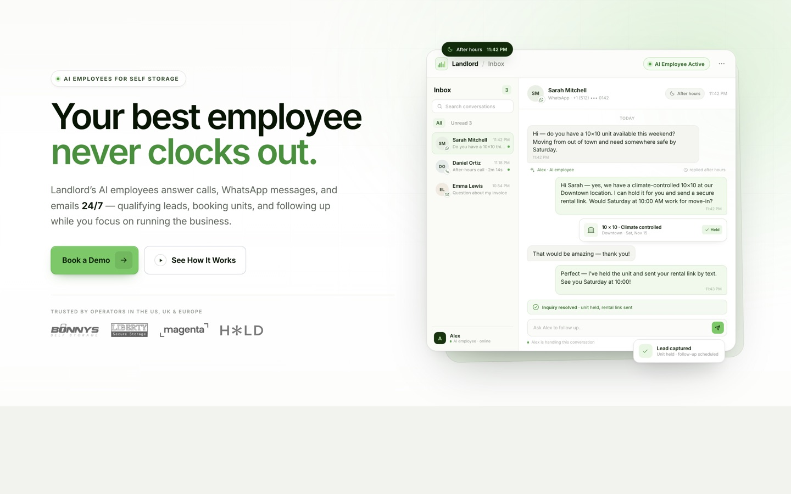

# Landlord — Hero Redesign & Design Review

A focused redesign of the Landlord homepage hero, with a standalone before/after review page.



## Routes

| Route | Purpose |
| --- | --- |
| `/` | Small index linking to both routes |
| `/design-review` | Before/after comparison, five-second read, rationale, product anatomy, mobile preview, brand continuity |
| `/hero-preview` | The proposed hero as a live, standalone page (also embedded in the review) |

## Live preview

- [Full design review](https://uselandlord-hero-redesign.onrender.com/design-review/)
- [Standalone hero preview](https://uselandlord-hero-redesign.onrender.com/hero-preview/)

Both review routes are `noindex, nofollow`. The review embeds `/hero-preview` in a scaled
iframe so the comparison always reflects the real component, not a static mockup.

## Run

```bash
npm install
npm run dev        # http://localhost:3000/design-review
npm run build      # production build
npm start          # serve the production build
```

## Design notes

- **Brand continuity:** original Landlord palette (`#081504`, `#7DC869`, `#F0F9F4`, `#E5E7EB`), Inter, and existing customer proof (Bonny's, Liberty, Magenta, HOLD).
- **Hero structure:** category eyebrow → outcome headline → plain-language explanation → primary demo CTA → secondary product walkthrough → customer logos → live product moment.
- **Product proof:** the inbox is a real DOM composition (not a screenshot) showing an after-hours WhatsApp inquiry resolved with a held 10×10 unit and a rental link. The conversation is illustrative; every other claim is drawn from the live Landlord site.
- **Responsive:** two columns above 980px, stacked below; CTAs become full-width 54px targets; the phone preview is a separate scaled frame.
- **Accessibility:** semantic headings, labeled iframes, alt text on every logo, visible focus styles, no horizontal overflow at 390px.

## Project layout

```
app/page.tsx                        index
app/design-review/                  review page + CSS module
app/hero-preview/                   live proposed hero route
components/NewHero.tsx              proposed hero
components/ProductPreview.tsx       live inbox visualization
components/LivePreview.tsx          scaled desktop iframe
components/PhonePreview.tsx         scaled mobile phone frame
components/BrowserChrome.tsx        browser frame chrome
public/brand/                       Landlord logo, customer logos, Inter
public/screens/current-hero-desktop.png
screenshots/                        QA captures (not served)
scripts/shoot.mjs                   headless Chrome screenshots
scripts/inspect.mjs                 headless layout inspection
```

## Source

Current hero screenshot captured from <https://uselandlord.com>. All copy, customer names,
logos, and proof points come from the live site (homepage, Sales & Customer Support page, FAQ).
No stats or endorsements were invented.
